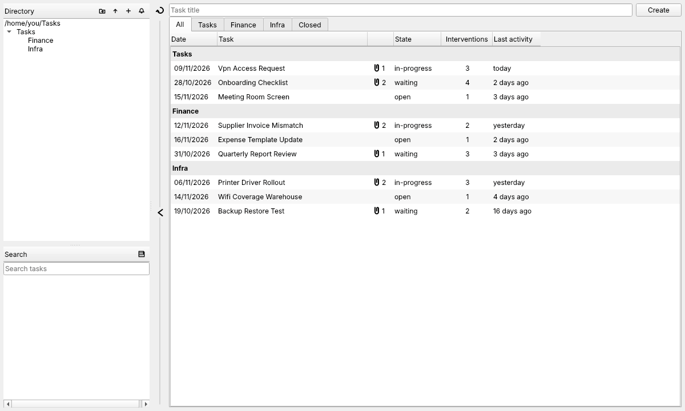
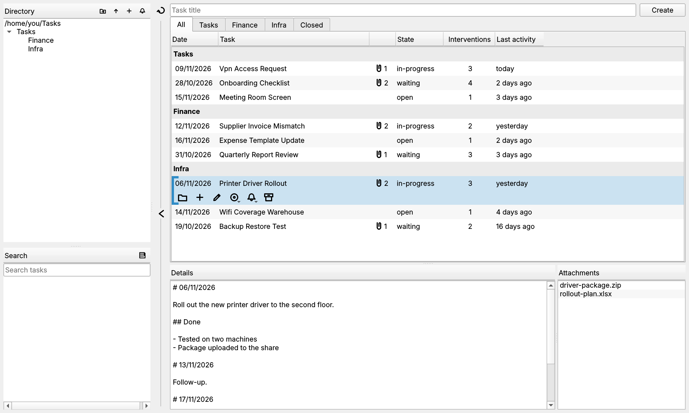
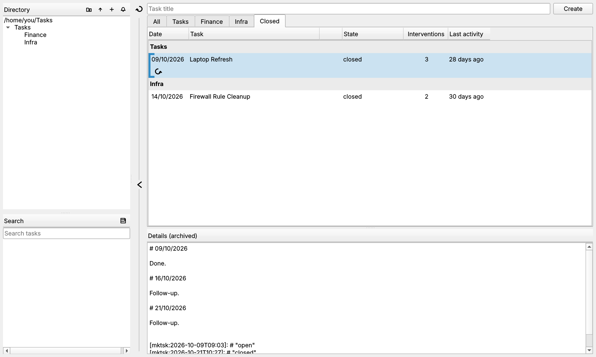

# mktsk

[](https://github.com/pedro-f-97/mktsk/actions/workflows/ci.yml)
[](https://github.com/pedro-f-97/mktsk/releases/latest)
[](pyproject.toml)
[](LICENSE)

**A ticket-style task tracker built on plain folders and Markdown.** No database, no
server, no account: every task is a dated folder with a Markdown file of notes, and the
files that belong to it sit right next to them. Use it from the command line or from a
desktop app.



## Why

I was used to working with tickets, and my current workplace had no ticketing tool. I
built mktsk to get the same workflow with nothing but the file system: one place per
piece of work, a dated log of every time I touched it, and the attachments kept with it.
I use it every day at work.

Because everything is plain files, the tasks open in any editor, sync with any shared
drive and outlive the tool itself.

## Features

- **One command per task.** `mktsk Printer Driver Rollout` creates
  `261106 - PrinterDriverRollout/PrinterDriverRollout.md` and opens it
- **Dated work log.** Running the same title on another day finds the task, on any date,
  and appends a new dated section instead of creating a duplicate
- **States.** `open`, `in-progress`, `waiting` and `closed`, mostly recorded
  automatically: coming back to a task moves it to `in-progress`
- **Safe archiving.** Closing a task compresses it into a zip that is verified before the
  folder is deleted; reopening restores it the same way. An interrupted operation never
  loses a task
- **Categories.** Subfolders keep tasks apart; drag a task onto a category to move it
- **Desktop app.** Tabs per category, sorting by last activity, live search by title or
  full content, a preview of the notes and attachments, drag-and-drop of files into a
  task, reminders as tray notifications
- **Cross-platform.** Windows and Linux, with names checked against Windows rules on
  every platform so a folder made on Linux still opens on Windows

## How a task looks on disk

```text
Tasks/
├── 261109 - VpnAccessRequest/
│   ├── VpnAccessRequest.md
│   └── access-form.pdf
├── 261009 - LaptopRefresh.zip        ← closed task
└── Infra/                            ← category
    └── 261106 - PrinterDriverRollout/
        ├── PrinterDriverRollout.md
        ├── driver-package.zip
        └── rollout-plan.xlsx
```

```markdown
# 06/11/2026

Roll out the new printer driver to the second floor.

## Done

- Tested on two machines

# 17/11/2026

Package uploaded to the share.


[mktsk:2026-11-06T09:42]: # "open"
[mktsk:2026-11-17T10:19]: # "in-progress"
```

Each `# dd/mm/yyyy` heading is one day of work. The state history is stored as Markdown
link references at the end, so it never shows up in rendered notes.

## Installation

**Executable.** Download the Windows or Linux build of the desktop app from the
[latest release](https://github.com/pedro-f-97/mktsk/releases/latest). No Python needed.

**With pip** (Python 3.12+):

```bash
python -m pip install ".[gui]"   # CLI and desktop app
python -m pip install .          # CLI only
```

On first run mktsk asks for the base folder and up to two categories, and saves them in a
config file shared by the CLI and the app.

## Command line

| Command | What it does |
| --- | --- |
| `mktsk <title>` | Create a task, or resume it with a new dated section |
| `mktsk --list [--only <state>]` | List tasks by last activity |
| `mktsk --state <title> <state>` | Set the state: `open`, `in-progress`, `waiting` |
| `mktsk --close <title>` | Archive the task into a verified zip |
| `mktsk --rename <folder> <title>` | Rename a task, keeping its date |
| `mktsk --new-category <name>` | Create a category folder |
| `mktsk --folder <path> ...` | Use another base folder for this run |

```text
$ mktsk --list
Tasks/
  09/11/2026  Vpn Access Request  (in-progress, 3 interventions, last activity 18/11/2026)
  28/10/2026  Onboarding Checklist  (waiting, 4 interventions, last activity 16/11/2026)
Infra/
  06/11/2026  Printer Driver Rollout  (in-progress, 3 interventions, last activity 17/11/2026)
```

## Desktop app

Run `mktsk-gui`, or `python -m mktsk`.



Select a task to get its actions (open folder, add today's section, rename, change state,
add a reminder, close) and a preview of its notes and attachments. Drop files on the
window to attach them to the selected task. Closed tasks live in their own tab and can be
reopened from the archive:



The app runs as a single instance and hides to the system tray when closed, so reminders
keep firing.

The [user guide](docs/USAGE.md) covers every command and behaviour in detail.

## Design

- **Files are the database.** Everything mktsk knows is read back from folder names and
  Markdown files, so editing a file by hand is always supported
- **Domain logic without Qt.** `mktsk/` holds the task rules and the CLI; `mktsk/gui/`
  is a PySide6 layer on top of it, one module per responsibility
- **Fail safe.** Archives are written under a temporary name and verified file by file
  before anything is deleted; extraction checks every member so no path escapes its folder
- **Documented rules.** [`docs/`](docs) describes the domain rules, the file format, the
  CLI and the GUI

## Development

```bash
python -m pip install -e ".[dev,gui]"
ruff check .
pyright mktsk/
pytest
```

CI runs lint, type checks and the full test suite on Ubuntu and Windows, with coverage
enforced at 95% or more. GUI tests run headless with pytest-qt. Tagged releases are built
by GitHub Actions: wheel, sdist and standalone executables made with PyInstaller.

The executables are not code signed, so antivirus software may flag them. The sdist
attached to each release is the corresponding source, as required by GPL-3.0 section 6.

The app icon is drawn in code; `python tools/make_icon.py` regenerates the icon files
when the drawing changes.

## License

GPL-3.0-or-later. See [LICENSE](LICENSE).
